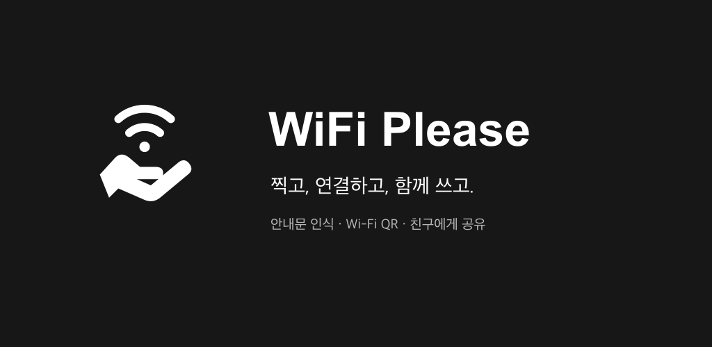
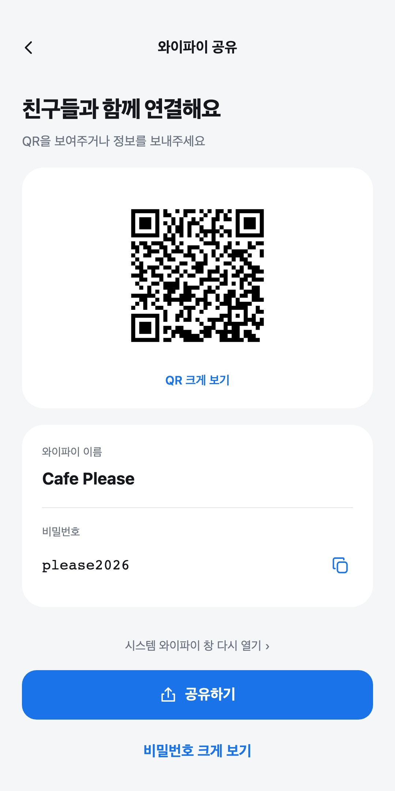
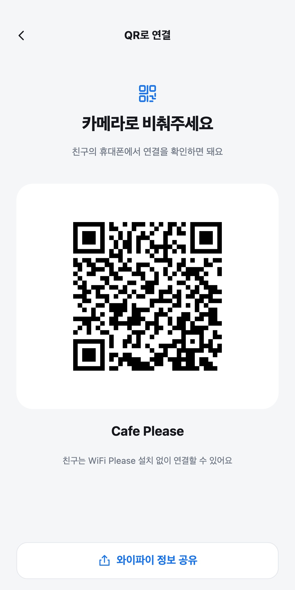
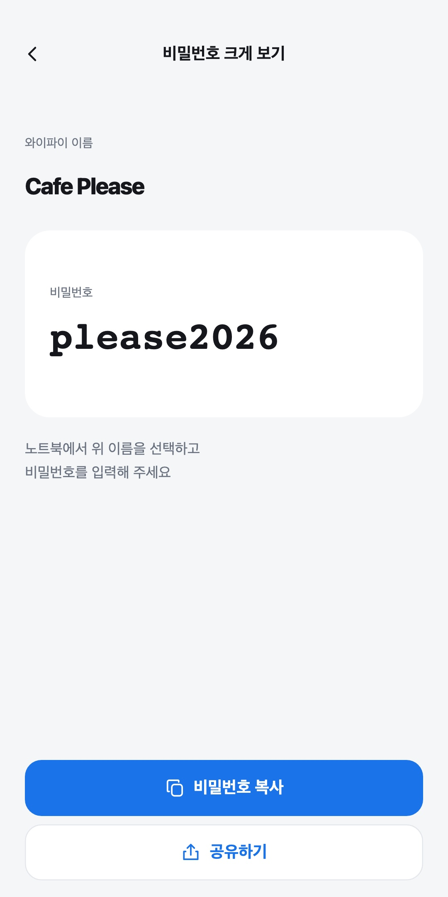

# WiFi Please



<h3 align="center">비밀번호, 이제 치지 말고 찍으세요.</h3>

<p align="center">찰칵 한 번이면 와이파이 연결 창이 열려요.<br>한 명이 찍으면 일행 모두 연결돼요.</p>

## 이런 적 있죠?

벽에 붙은 `Cafe_2F_5G` / `Lk9#mQ2!xv`. 화면을 확대하고, 대문자인지 소문자인지 헷갈리고, 한 글자 틀려서 처음부터 다시 칩니다. 옆자리 친구는 "비번 뭐야?"라고 묻고, 노트북에서 또 칩니다.

| 지금까지 | WiFi Please |
| --- | --- |
| 와이파이 목록에서 이름 찾기 | 안내문을 **찰칵** |
| 비밀번호 한 글자씩 보며 입력 | 이름과 비밀번호가 채워진 연결 창이 **바로** 열림 |
| 틀리면 처음부터 다시 | **저장**만 누르면 끝 |
| 일행마다 같은 일 반복 | 친구에게는 **QR**, 노트북에는 **큰 비밀번호** |

## 이래서 달라요

- **중간 화면 없이 바로 연결 창**: 사진을 찍으면 앱 화면을 거치지 않고 Android 와이파이 연결 창이 곧바로 뜹니다.
- **사진 속 이름이 조금 틀려도 맞춰 줘요**: 주변 와이파이 목록과 대조해 실제 와이파이 이름과 보안 방식으로 고쳐 줍니다.
- **한 명이 찍으면 모두 연결**: 카카오톡 등으로 보내거나, 친구 휴대폰에 QR을 보여 주거나, 노트북용으로 비밀번호를 크게 띄울 수 있습니다.
- **가입도 광고도 없어요**: 비밀번호는 앱이 켜져 있는 동안 메모리에만 두고 저장하지 않습니다. QR은 휴대폰 안에서만 읽습니다.

## 화면

<table>
  <tr>
    <td align="center"></td>
    <td align="center"></td>
    <td align="center"></td>
  </tr>
  <tr>
    <td align="center">공유</td>
    <td align="center">QR 크게 보기</td>
    <td align="center">비밀번호 크게 보기</td>
  </tr>
</table>

## 사용 방법

1. 앱을 열고 와이파이 안내문을 촬영합니다. 미리 찍어 둔 사진을 고르거나, 와이파이 QR을 카메라에 비춰도 됩니다.
2. 이름과 비밀번호가 채워진 Android 와이파이 연결 창이 뜨면 저장을 누릅니다.
3. 연결 창을 닫으면 공유 화면이 열립니다. 카카오톡 등으로 정보를 보내거나, 친구 휴대폰에는 QR을, 노트북에는 큰 비밀번호를 보여 줍니다.

사진은 와이파이 정보를 읽기 위해 서버를 거쳐 AI로 전송되므로, 처음 한 번 안내를 보고 동의한 뒤에 사용합니다. QR은 휴대폰 안에서만 처리합니다.

## 이런 분께 맞아요

- 카페, 식당, 숙소, 공유 오피스처럼 와이파이 안내문이 붙어 있는 곳을 자주 가는 분
- 긴 비밀번호를 직접 입력하다 자주 틀리는 분
- 일행이나 손님에게 와이파이를 알려 줘야 하는 분
- 노트북처럼 사진을 찍기 어려운 기기에도 비밀번호를 옮겨야 하는 분

## 그 밖의 기능

- **갤러리 사진으로 인식**: 미리 찍어 둔 안내문 사진도 고를 수 있습니다.
- **와이파이 QR 인식**: 카메라에 와이파이 QR을 비추면 서버를 거치지 않고 바로 읽습니다.
- **비밀번호 복사**: 공유 화면에서 비밀번호를 그대로 복사합니다.
- **이미 연결된 와이파이 공유**: Android 기본 QR 공유 기능으로 가는 방법을 안내합니다.

## 동작 방식

```
사진 ──→ 프록시 서버 ──→ Claude Haiku 5.5가 이름과 비밀번호 인식 ──→ 시스템 와이파이 창
QR 코드 ──→ 앱에서 바로 해석 ────────────────────────────────────────┘
```

- 사진 인식은 Cloudflare Workers 프록시 서버를 거쳐 Claude Haiku 5.5가 처리합니다. API 키는 서버에만 있고 앱에는 없습니다.
- 서버는 Play Integrity 검증과 설치별·전체 사용 횟수 제한을 통과한 요청만 AI에 전달합니다.
- 사진을 처음 보내기 전에 외부 전송을 안내하고 동의를 받습니다. QR은 동의 없이 기기 안에서 처리합니다.
- 와이파이 비밀번호는 앱 메모리에만 두고 저장소, URL, 로그에 남기지 않습니다.
- 시스템 연결 창은 Android 11 이상의 `ACTION_WIFI_ADD_NETWORKS`를 Kotlin 네이티브 모듈로 호출합니다.

## 지원 환경

- Android 11 이상
- iOS는 아직 지원하지 않습니다.

## 기술 스택

- [Expo](https://expo.dev) SDK 57, React Native 0.86, TypeScript
- [Expo Router](https://docs.expo.dev/router/introduction/)
- Expo Modules API (Kotlin)
- [Cloudflare Workers](https://developers.cloudflare.com/workers/), Durable Objects
- [Claude API](https://platform.claude.com/docs/en/build-with-claude/vision) (Claude Haiku 5.5)
- Vitest

## 시작하기

필요한 것

- Node.js 22.13 이상, Java 17
- [Android Studio](https://developer.android.com/studio) (Android SDK 포함)
- Android 11 이상 실기기 (에뮬레이터에서는 와이파이 기능을 제대로 확인할 수 없습니다)

```bash
npm install

# 휴대폰을 USB로 연결하고 USB 디버깅을 켠 뒤 실행
npx expo run:android
```

Expo Go는 쓰지 않고 development build를 사용합니다. `android/` 폴더는 자동 생성되므로 직접 수정하지 않고 `app.json`과 config plugin으로 설정합니다.

QR 인식, 연결 창, 공유는 서버 없이 동작합니다. 사진 인식은 `.env`의 `EXPO_PUBLIC_SCAN_API_URL` 서버를 사용하며, 직접 서버를 띄우는 방법은 `server/`와 [개발 문서](docs/development.md)를 참고하세요.

## 검사

```bash
npx expo lint      # 코드 검사
npx tsc --noEmit   # 타입 검사
npm test           # Vitest 전체 테스트
```

## 폴더 구조

```
src/
  app/               화면과 Expo Router 라우팅
  components/        앱 공통 UI
  constants/         공통 색상과 글꼴
  features/wifi/     촬영, 인식, 연결, 공유 기능
modules/wifi-manager/  Android 와이파이 연결 네이티브 모듈 (Kotlin)
server/              사진 인식 프록시 서버 (Cloudflare Workers)
shared/              앱과 서버가 함께 쓰는 정책 원문과 요청 계약
scripts/             출시 전 검사
plugins/             네이티브 프로젝트 설정 변경
vendor/              보안 패치를 적용한 의존성 사본
docs/                개발·출시·운영 문서
assets/              아이콘, 스플래시, 스토어 이미지
```

파일별 역할과 분리 원칙은 [AGENTS.md](AGENTS.md#파일-구조와-분리-원칙)에 정리되어 있습니다.

## 문서

- [개발 문서](docs/development.md): 식별자, 아이콘 내보내기, EAS 빌드, 검증 범위, 사진 인식 보호 설정
- [Google Play 출시 요건](docs/google-play-release.md)
- [사용량 제한과 운영 비용](docs/usage-capacity.md)
- 개인정보처리방침과 이용약관 원문: [`shared/privacy.json`](shared/privacy.json), [`shared/terms.json`](shared/terms.json)
